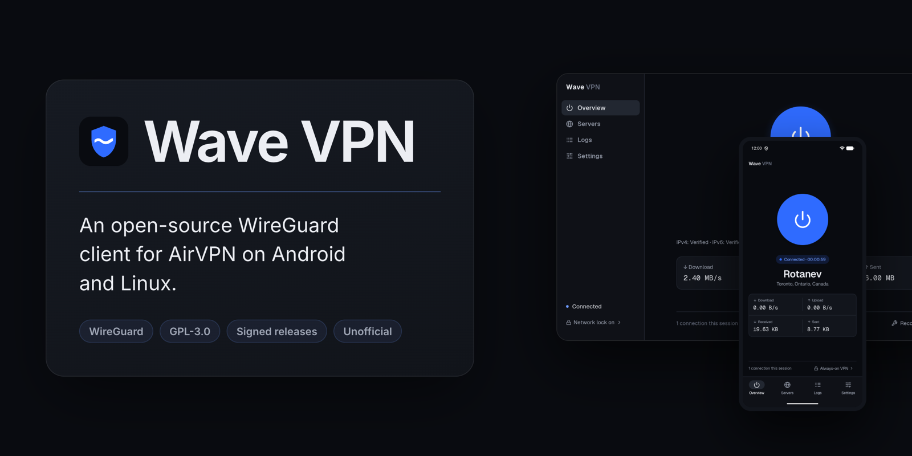
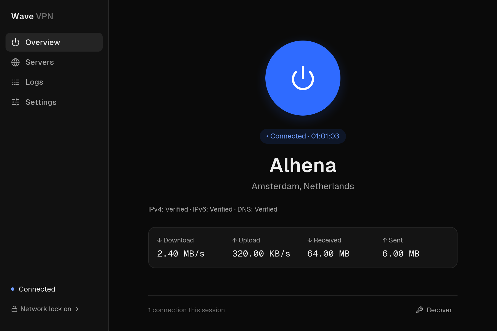
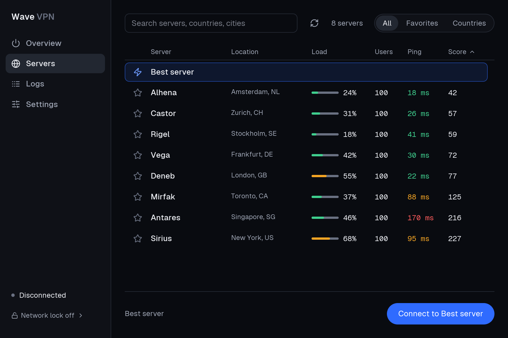

<p align="center">
  
</p>

<p align="center">
  <a href="https://github.com/VesselWave/wave-vpn-desktop/releases/latest"></a>
  <a href="LICENSE"></a>
  
</p>

An unofficial WireGuard client for [AirVPN](https://airvpn.org) on the Linux desktop. Sign in with your AirVPN account, pick a server and connect, with a Network Lock firewall that keeps traffic inside the tunnel. Open source, written in Rust, with signed releases.

**[Download from vpn.vwave.me](https://vpn.vwave.me)** · [Release notes](docs/RELEASE-v0.1.1.md) · [Android app](https://github.com/VesselWave/wave-vpn-mobile) · [Forum thread](https://airvpn.org/forums/topic/82017-wave-vpn-open-source-wireguard-client-for-android-and-linux-unofficial-v011/)

<p align="center">
  
  
</p>

- Sign in with your AirVPN account; credentials go to your desktop keyring
- Best-server choice, or a sortable server table with search, favorites and countries
- **Network Lock** (opt-in): an nftables firewall that blocks traffic outside the tunnel, and once on, stays on after Disconnect, Quit or a crash until you turn it off
- Checks every connection: AirVPN confirms the tunnel's IPv4 and IPv6 identity and that your DNS reaches AirVPN
- **Recover** undoes Wave's own DNS and tunnel changes after a failure, even before you sign in
- Tray indicator, connection log and a reviewed support report with nothing private in it
- Imports your existing Eddie account (read-only), and exports WireGuard profiles for other tools

> [!NOTE]
> **Wave VPN is in early release.** Anyone is welcome to use it, but it hasn't been fully tested on every device and system yet.

## Install

Built for x86_64 Linux with systemd; tested most on Ubuntu 24.04 GNOME. Download the file for your system from [vpn.vwave.me](https://vpn.vwave.me/#download) or the [latest release](https://github.com/VesselWave/wave-vpn-desktop/releases/latest), then install it:

| System | Download | Install with |
| --- | --- | --- |
| Ubuntu, Debian, Mint | [.deb](https://github.com/VesselWave/wave-vpn-desktop/releases/download/v0.1.2/wave-vpn_0.1.2-1_amd64.deb) | `sudo apt install ./wave-vpn_0.1.2-1_amd64.deb` |
| Fedora | [.rpm](https://github.com/VesselWave/wave-vpn-desktop/releases/download/v0.1.2/wave-vpn-0.1.2-1.x86_64.rpm) | `sudo dnf install ./wave-vpn-0.1.2-1.x86_64.rpm` |
| openSUSE | [.rpm](https://github.com/VesselWave/wave-vpn-desktop/releases/download/v0.1.2/wave-vpn-0.1.2-1.x86_64.rpm) | `sudo zypper install --allow-unsigned-rpm ./wave-vpn-0.1.2-1.x86_64.rpm` |
| Arch, CachyOS, Manjaro | [.pkg.tar.zst](https://github.com/VesselWave/wave-vpn-desktop/releases/download/v0.1.2/wave-vpn-0.1.2-1-x86_64.pkg.tar.zst) | `sudo pacman -U ./wave-vpn-0.1.2-1-x86_64.pkg.tar.zst` |
| Anything else | [.tar.gz](https://github.com/VesselWave/wave-vpn-desktop/releases/download/v0.1.2/wave-vpn-0.1.2-x86_64-unknown-linux-gnu.tar.gz) | Extract it, open a terminal in the folder, run `./install.sh` |

Run the command in the folder you downloaded to. Packages bring in WireGuard tools, iproute2, nftables and libsecret; the tarball's installer offers to install them with your package manager. Then open **Wave VPN** from your app menu.

Wave VPN connects through a small root-owned helper that it authorizes for your user once, so connecting never asks for a password. Installing from a terminal with `sudo` sets it up; otherwise your first Connect asks for your password. To uninstall, remove the `wave-vpn` package (`sudo apt remove wave-vpn`, `sudo dnf remove wave-vpn`, `sudo pacman -R wave-vpn`) or run `sudo wave-vpn-uninstall` for the tarball. Both disconnect and turn off Network Lock first. More in the [user guide](docs/USER-GUIDE.md).

## Verify your download

Every release ships signed SHA-256 checksums for all its files. The release key is on [keys.openpgp.org](https://keys.openpgp.org/search?q=414018C0BBB8C0A70A80BF570AA32CCB2C0B3951) and [vpn.vwave.me](https://vpn.vwave.me/#verify):

```text
4140 18C0 BBB8 C0A7 0A80  BF57 0AA3 2CCB 2C0B 3951
```

```sh
gpg --recv-keys 414018C0BBB8C0A70A80BF570AA32CCB2C0B3951
gpg --verify wave-vpn-0.1.2-x86_64-unknown-linux-gnu-SHA256SUMS.asc \
             wave-vpn-0.1.2-x86_64-unknown-linux-gnu-SHA256SUMS
sha256sum --ignore-missing -c wave-vpn-0.1.2-x86_64-unknown-linux-gnu-SHA256SUMS
```

If the fingerprint differs from this one, from [SECURITY.md](SECURITY.md) and from the website, don't install; report it privately.

## How it stays safe

The app runs as your user. Networking goes through a socket-activated helper that accepts only a fixed set of actions from the user it authorized, never shell commands or raw config. It sets up its own WireGuard interface, routes and nftables table, and keeps a root-only recovery record so a crash can always be undone. Wave VPN talks only to AirVPN: no analytics, no telemetry, and support reports are never uploaded. Details in the [user guide](docs/USER-GUIDE.md) and [SECURITY.md](SECURITY.md).

## Building

Needs a recent stable Rust. VPN connections need Linux; the UI also builds on macOS.

```sh
cargo test --locked --all-targets
cargo clippy --locked --all-targets -- -D warnings
cargo build --release --locked
./scripts/install.sh            # or build packages: scripts/package.sh target/packages
```

More, including the isolated network test suite, in [CONTRIBUTING.md](CONTRIBUTING.md); test evidence is indexed in [docs/](docs/README.md).

## How this was made

Most of Wave VPN's code, tests and documentation were written by AI coding agents, **Claude Opus 5.5** and **GPT 6.1 Sol**, working under the maintainer's direction. The maintainer sets the scope, makes the product and security decisions, provides the test devices, lab machines and AirVPN account, holds the signing keys, and decides what gets merged and released.

That's why everything is published: the source, the protocol references in [provenance](docs/PROVENANCE.md), and every [test report](docs/README.md), including the failures. Please judge the app by that evidence, not by who or what typed it, and report anything that looks wrong.

---

GPL-3.0-or-later. Independent project, not affiliated with or endorsed by AirVPN. Report security issues privately to **vesselwave@protonmail.com** ([security policy](SECURITY.md)).

## Published history privacy

The repository history and release packages were sanitized on 2026-11-03.
Lab records use example identities and addresses; private management details
are omitted. Sanitized release archives and fresh signed checksum manifests are
available. The APK and executable bytes are unchanged. Download the current
archives, checksums and signatures together. The GitHub repositories were
subsequently recreated under the same names without the old PR threads. Existing
clones may retain old history.
